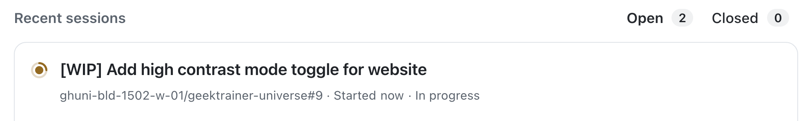

En los dos últimos ejercicios has pedido al agente en la nube de Copilot que se ocupe de tres tareas diferentes para mejorar la experiencia de usuario y añadir funcionalidades. Aunque está diseñado para trabajar de forma autónoma y asíncrona, sigue siendo importante poder supervisar esas tareas.

Hay varias herramientas para gestionar las tareas asignadas al agente en la nube, como la [página de agentes][agents-page] de GitHub.com. Desde este centro de control puedes ver las tareas de los agentes que tienen solicitudes de incorporación de cambios abiertas. También puedes explorar las operaciones realizadas e intervenir en una sesión en curso para orientarla.

En este ejercicio:

- explorarás la página de agentes para supervisar las tareas del agente en la nube.
- dirigirás una sesión en curso para solicitar una funcionalidad adicional.

## Escenario

Después de asignar al agente la creación de un modo de alto contraste, el equipo decidió que también sería buen momento para añadir un modo claro. Como ya se estaba actualizando el estilo del sitio y añadiendo una función de cambio de modo, parecía razonable incluirlo. Orientarás el trabajo del agente para que añada el modo claro junto con el alto contraste.

## Revisar las tareas del agente en la nube de Copilot

Consulta el estado actual de las tareas asignadas al agente en la nube de Copilot.

1. Ve a la [página de agentes de Copilot](https://github.com/copilot/agents).
2. Observa la lista de tareas en el panel principal y en el panel izquierdo. Deberías ver las tareas que has asignado a Copilot, entre ellas:
   - actualizar la documentación del código base.
   - generar interfaces de programación de aplicaciones (API) para modificar juegos.
   - añadir un modo de alto contraste al sitio web.
3. Selecciona una de las tareas en curso. Revisa las operaciones que ha realizado Copilot, como:
   - obtener el código del repositorio.
   - crear el entorno de trabajo de Copilot.
   - configurar servidores del Model Context Protocol (MCP).
   - realizar los distintos pasos necesarios para completar la tarea.

> [!NOTE]
> Los pasos exactos de la lista dependerán del estado del trabajo de Copilot y del enfoque que haya seguido.

4. Observa también el panel de solicitud de incorporación de cambios (PR) que aparece a la derecha. Permite consultar la PR y los archivos modificados para supervisar el trabajo.

## Dirigir el agente en la nube

Ahora que has visto las tareas activas, pide a Copilot que añada el selector del modo claro mientras trabaja en el modo de alto contraste.

1. Selecciona la sesión relacionada con la creación del modo de alto contraste. El título exacto dependerá del nombre que Copilot haya elegido y del estado actual del trabajo.

    

2. Observa la sesión durante unos minutos, hasta que indique que ha terminado la configuración y ha empezado a trabajar. Lo notarás cuando aparezcan mensajes parecidos a los siguientes.
3. En el cuadro de diálogo **Steer active session while Copilot is working**, escribe este prompt:

    ```plaintext
    While we are working on a high contrast mode, let's also add a light mode. There should be a switch for this mode as well where users can select their desired display mode.
    ```

    

4. Pulsa <kbd>Enter</kbd> para enviar el prompt.
5. Observa cómo Copilot confirma que lo ha recibido y lo incorpora al flujo de trabajo.

## Dejar que Copilot trabaje

Como antes, Copilot seguirá trabajando en la tarea actualizada. Incorporará la nueva solicitud cuando termine el paso que estaba ejecutando al recibir el mensaje.

Este proceso también puede tardar varios minutos. Puedes aprovechar el tiempo para hacer una pausa y repasar lo que has aprendido y explorado.

## Resumen y pasos siguientes

Has explorado la página de agentes de Copilot, el centro de control para supervisar y orientar las tareas del agente en la nube de GitHub Copilot. Desde allí puedes hacer seguimiento de las tareas activas y completadas, revisar el trabajo y redirigir una tarea en curso para ajustar su alcance o proporcionar más indicaciones.

Has explorado estos conceptos:

- has explorado el centro de control y la página de agentes para supervisar las tareas del agente en la nube.
- has redirigido una sesión en curso para solicitar una funcionalidad adicional.

Mientras Copilot termina de trabajar en las funciones de accesibilidad, puedes [iterar sobre las solicitudes de incorporación de cambios que ha creado][next-lesson].

## Recursos

- [Página de agentes de Copilot][agents-page]
- [Acerca de los agentes personalizados][custom-agents]

---

| [← Lección anterior: Agentes personalizados][previous-lesson] | [Siguiente lección: Iterar sobre el trabajo de Copilot →][next-lesson] |
|:--|--:|

[previous-lesson]: ../3-custom-agents/
[next-lesson]: ../5-iterating/
[agents-page]: https://github.blog/changelog/2025-07-03-agents-page-for-copilot-coding-agent-in-public-preview
[custom-agents]: https://docs.github.com/copilot/concepts/agents/cloud-agent/about-custom-agents
